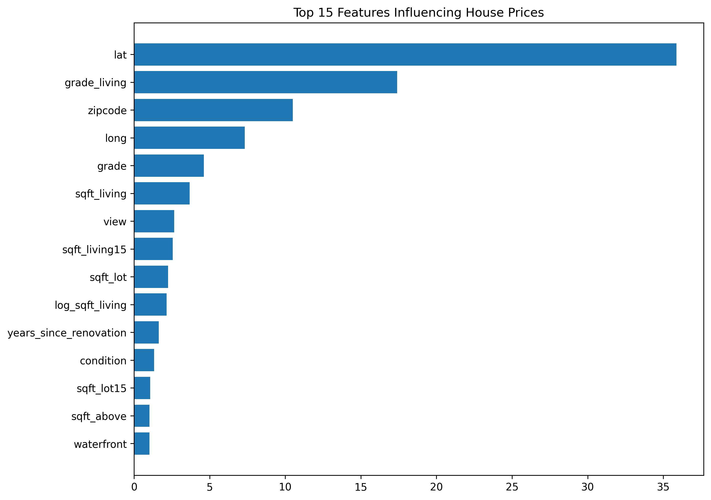
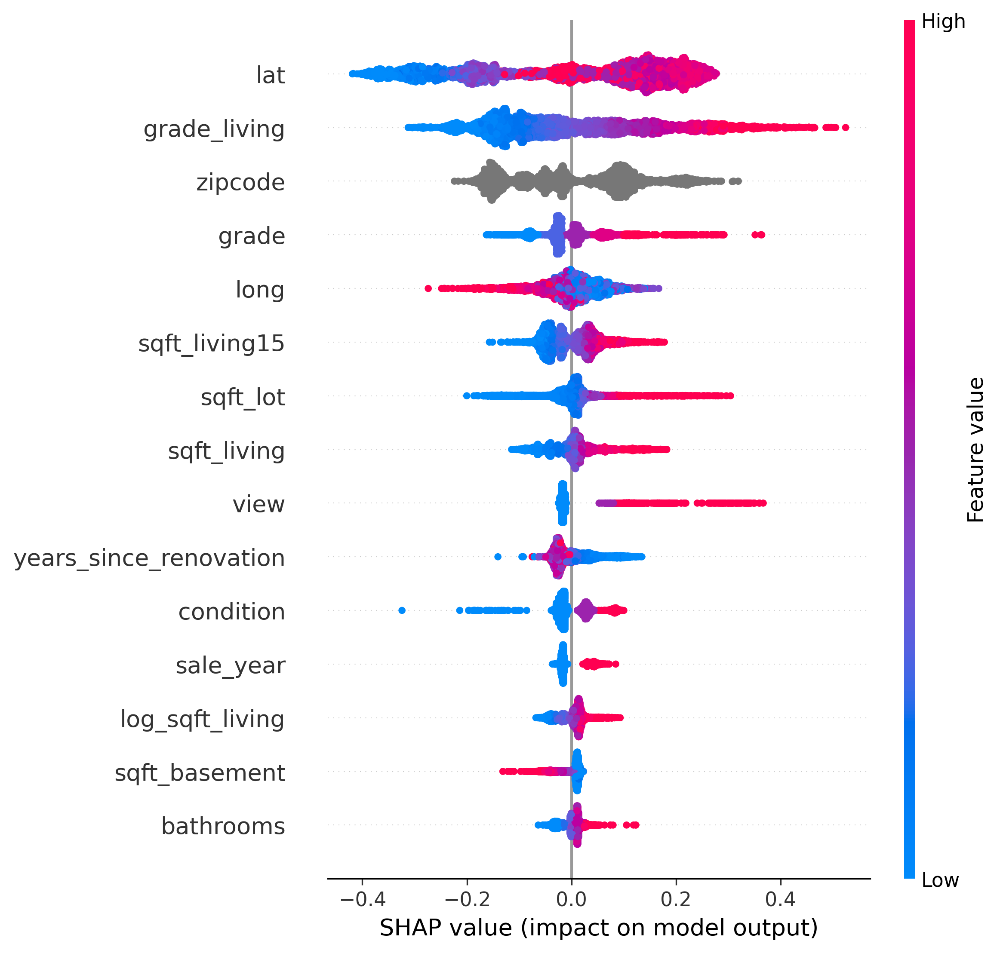
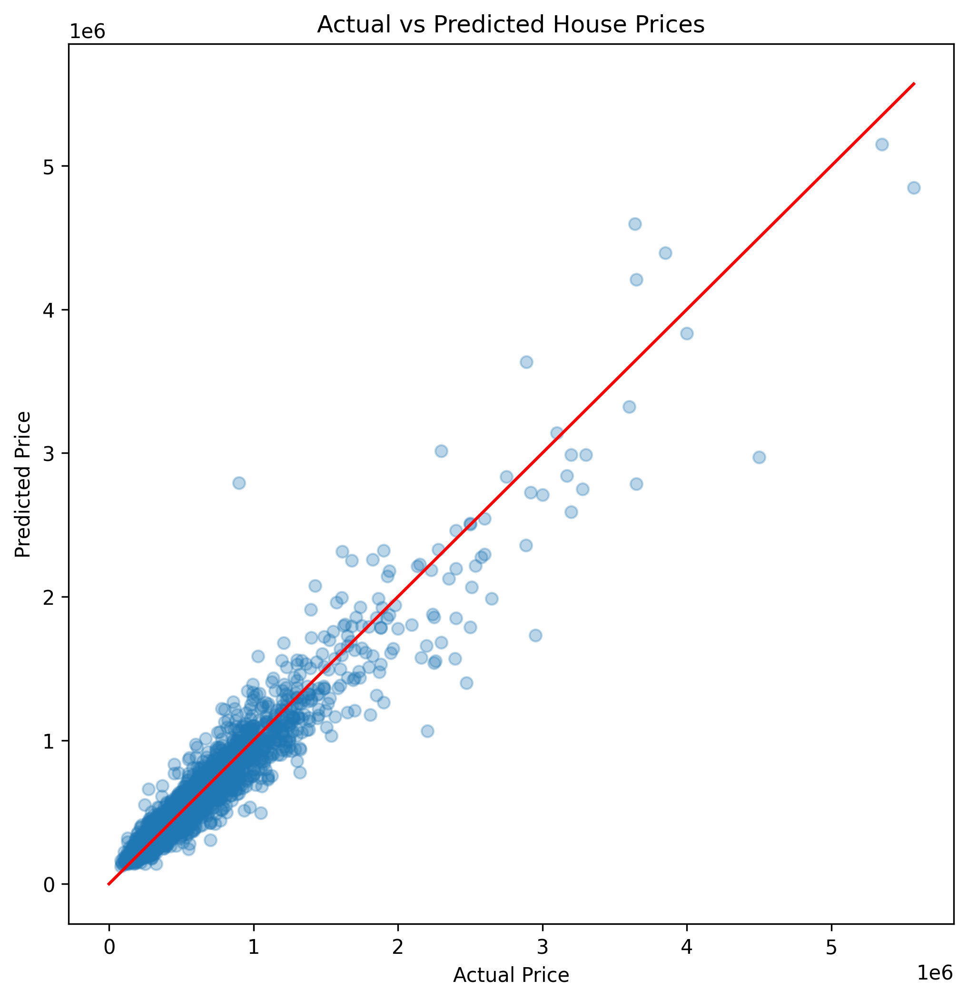

# King County House Price Prediction using Machine Learning

## Overview

Machine learning regression project to predict residential property prices in King County, Washington.

The objective is to develop an interpretable model capable of estimating house prices based on property characteristics and geographic information.

# Business Problem

Accurate house valuation is important for:

* Real estate pricing
* Mortgage estimation
* Investment analysis
* Automated appraisal systems

The goal is to build a regression model that can estimate property prices with acceptable error.

# Dataset

Dataset:
King County House Sales Dataset

Observations:
21,613 houses

Features include:

* Living area
* Number of bedrooms and bathrooms
* House grade
* Location coordinates
* Zip code
* Renovation information
* Waterfront presence

# Methodology

## Data Processing

Performed:

* Data cleaning
* Duplicate removal
* Missing value analysis
* Date transformation
* Feature engineering

Created features:

* House age
* Renovation status
* Years since renovation
* Log transformation of living area
* Grade × living area interaction

# Modeling

Models evaluated:

* Linear Regression
* Ridge Regression
* Random Forest
* Gradient Boosting
* XGBoost
* LightGBM
* CatBoost

Final model:

**CatBoost Regressor**

Hyperparameter optimization:

**Optuna**

# Model Explainability

Used:

## SHAP

To understand how individual features influence predictions.

## Feature Importance

To identify the most relevant variables.

# Results

Final model performance:

| Metric | Value    |
| ------ | -------- |
| R²     | 91.8%    |
| MAE    | $61,193  |
| RMSE   | $111,628 |
| MAPE   | 11.1%    |

Interpretation:

The model explains approximately 92% of price variability and predicts house prices with an average error of around $61K.

# Key Findings

### 1. Location is the strongest predictor

Latitude, longitude, and zipcode were among the most influential features.

### 2. Property quality matters

House grade and living area strongly affect predicted prices.

### 3. Luxury properties are harder to predict

Prediction errors increase for very expensive homes because there are fewer examples.

# Results

## Feature Importance

## Model Explainability with SHAP

## Prediction Performance

## Business Interpretation

The model predicts house prices with an average error of approximately $61K.

Considering the average property value in the dataset, this represents an error margin of approximately 11%.

This makes the model useful as a decision-support tool for preliminary property valuation.